<!--
  Everything visual on this page is generated: generator/ renders the SVGs from
  generator/profile.toml, and .github/workflows/profile.yml refreshes the live
  numbers and the snake every day.
-->

<a href="https://swayampatil.vercel.app"><picture><source media="(prefers-color-scheme: dark)" srcset="assets/hero-dark.svg"></picture></a>

<a href="mailto:patilswayam96@gmail.com"><picture><source media="(prefers-color-scheme: dark)" srcset="assets/btn-email-dark.svg"></picture></a>
<a href="https://swayampatil.vercel.app"><picture><source media="(prefers-color-scheme: dark)" srcset="assets/btn-portfolio-dark.svg"></picture></a>
<a href="https://www.linkedin.com/in/swayampatil"><picture><source media="(prefers-color-scheme: dark)" srcset="assets/btn-linkedin-dark.svg"></picture></a>
<a href="https://leetcode.com/SwayamP/"><picture><source media="(prefers-color-scheme: dark)" srcset="assets/btn-leetcode-dark.svg"></picture></a>
<a href="https://drive.google.com/file/d/1P1EvdPLFmHG16GUYRoAI6XvwXH_ZdRf8/view"><picture><source media="(prefers-color-scheme: dark)" srcset="assets/btn-resume-dark.svg"></picture></a>

<picture><source media="(prefers-color-scheme: dark)" srcset="assets/about-dark.svg"></picture>

<picture><source media="(prefers-color-scheme: dark)" srcset="assets/impact-dark.svg"></picture>

<picture><source media="(prefers-color-scheme: dark)" srcset="assets/journey-dark.svg"></picture>

<picture><source media="(prefers-color-scheme: dark)" srcset="assets/stack-dark.svg"></picture>

<picture><source media="(prefers-color-scheme: dark)" srcset="assets/projects-dark.svg"></picture>

<a href="https://voicecallassistant.com">AI Receptionist ↗</a> &nbsp;/&nbsp;
<a href="https://github.com/Swayam26262/Intervexa">Intervexa ↗</a> &nbsp;/&nbsp;
<a href="https://github.com/Swayam26262/FixMyResume">FixMyResume ↗</a> &nbsp;/&nbsp;
<a href="https://github.com/Swayam26262/Data-Story">DataStory AI ↗</a> &nbsp;/&nbsp;
<a href="https://write-flow-delta.vercel.app">WriteFlow ↗</a> &nbsp;/&nbsp;
<a href="https://github.com/Swayam26262/YT2Notes">YT2Notes ↗</a>
 
Also on the shelf: <a href="https://cineguide.streamlit.app">CineGuide</a> / <a href="https://github.com/Swayam26262/WhisperOnce">WhisperOnce</a> / <a href="https://github.com/Swayam26262/SummarizeAI">SummarizeAI</a> / <a href="https://github.com/Swayam26262/Portfolio">Portfolio</a>

<picture><source media="(prefers-color-scheme: dark)" srcset="assets/telemetry-dark.svg"></picture>

<picture><source media="(prefers-color-scheme: dark)" srcset="assets/snake-dark.svg"></picture>

<!-- CONNECT4:START -->
<picture><source media="(prefers-color-scheme: dark)" srcset="assets/connect4/header-dark.svg"></picture>

<b>Game 1</b>, move 1. You play orange and open; the AI plays black.

<a href="https://github.com/Swayam26262/Swayam26262/issues/new?title=c4%7Cdrop%7C1&body=Just%20press%20%2A%2ACreate%2A%2A%20%28or%20%2A%2ASubmit%20new%20issue%2A%2A%29%2C%20no%20need%20to%20write%20anything.%0A%0AA%20GitHub%20Action%20will%20drop%20your%20disc%2C%20let%20the%20AI%20reply%20and%20update%20the%20board%20in%20about%20a%20minute."><picture><source media="(prefers-color-scheme: dark)" srcset="assets/connect4/col-1-dark.svg"></picture></a><a href="https://github.com/Swayam26262/Swayam26262/issues/new?title=c4%7Cdrop%7C2&body=Just%20press%20%2A%2ACreate%2A%2A%20%28or%20%2A%2ASubmit%20new%20issue%2A%2A%29%2C%20no%20need%20to%20write%20anything.%0A%0AA%20GitHub%20Action%20will%20drop%20your%20disc%2C%20let%20the%20AI%20reply%20and%20update%20the%20board%20in%20about%20a%20minute."><picture><source media="(prefers-color-scheme: dark)" srcset="assets/connect4/col-2-dark.svg"></picture></a><a href="https://github.com/Swayam26262/Swayam26262/issues/new?title=c4%7Cdrop%7C3&body=Just%20press%20%2A%2ACreate%2A%2A%20%28or%20%2A%2ASubmit%20new%20issue%2A%2A%29%2C%20no%20need%20to%20write%20anything.%0A%0AA%20GitHub%20Action%20will%20drop%20your%20disc%2C%20let%20the%20AI%20reply%20and%20update%20the%20board%20in%20about%20a%20minute."><picture><source media="(prefers-color-scheme: dark)" srcset="assets/connect4/col-3-dark.svg"></picture></a><a href="https://github.com/Swayam26262/Swayam26262/issues/new?title=c4%7Cdrop%7C4&body=Just%20press%20%2A%2ACreate%2A%2A%20%28or%20%2A%2ASubmit%20new%20issue%2A%2A%29%2C%20no%20need%20to%20write%20anything.%0A%0AA%20GitHub%20Action%20will%20drop%20your%20disc%2C%20let%20the%20AI%20reply%20and%20update%20the%20board%20in%20about%20a%20minute."><picture><source media="(prefers-color-scheme: dark)" srcset="assets/connect4/col-4-dark.svg"></picture></a><a href="https://github.com/Swayam26262/Swayam26262/issues/new?title=c4%7Cdrop%7C5&body=Just%20press%20%2A%2ACreate%2A%2A%20%28or%20%2A%2ASubmit%20new%20issue%2A%2A%29%2C%20no%20need%20to%20write%20anything.%0A%0AA%20GitHub%20Action%20will%20drop%20your%20disc%2C%20let%20the%20AI%20reply%20and%20update%20the%20board%20in%20about%20a%20minute."><picture><source media="(prefers-color-scheme: dark)" srcset="assets/connect4/col-5-dark.svg"></picture></a><a href="https://github.com/Swayam26262/Swayam26262/issues/new?title=c4%7Cdrop%7C6&body=Just%20press%20%2A%2ACreate%2A%2A%20%28or%20%2A%2ASubmit%20new%20issue%2A%2A%29%2C%20no%20need%20to%20write%20anything.%0A%0AA%20GitHub%20Action%20will%20drop%20your%20disc%2C%20let%20the%20AI%20reply%20and%20update%20the%20board%20in%20about%20a%20minute."><picture><source media="(prefers-color-scheme: dark)" srcset="assets/connect4/col-6-dark.svg"></picture></a><a href="https://github.com/Swayam26262/Swayam26262/issues/new?title=c4%7Cdrop%7C7&body=Just%20press%20%2A%2ACreate%2A%2A%20%28or%20%2A%2ASubmit%20new%20issue%2A%2A%29%2C%20no%20need%20to%20write%20anything.%0A%0AA%20GitHub%20Action%20will%20drop%20your%20disc%2C%20let%20the%20AI%20reply%20and%20update%20the%20board%20in%20about%20a%20minute."><picture><source media="(prefers-color-scheme: dark)" srcset="assets/connect4/col-7-dark.svg"></picture></a> <picture><source media="(prefers-color-scheme: dark)" srcset="assets/connect4/board-1-0-dark.svg"></picture>

<b>Scoreboard and how it works</b>

| Humans | AI | Draws |
| :-: | :-: | :-: |
| 0 | 0 | 0 |

**How it works:** a column opens a pre-filled issue. A GitHub Action reads it, drops your disc, lets a negamax AI with alpha-beta pruning (6 plies deep) reply, redraws the board and commits this README. Everyone plays the same game, so coordinate in the issues if you want to win.

<!-- CONNECT4:END -->

<a href="mailto:patilswayam96@gmail.com"><picture><source media="(prefers-color-scheme: dark)" srcset="assets/footer-dark.svg"></picture></a>

This page is a program: the artwork is rendered by <a href="https://github.com/Swayam26262/Swayam26262/tree/main/generator">generator/</a> and refreshed daily by <a href="https://github.com/Swayam26262/Swayam26262/blob/main/.github/workflows/profile.yml">a GitHub Action</a>.
