<!--
  Hey, curious one. Everything visual on this page is generated:
  generator/ renders the SVGs from generator/profile.toml, and
  .github/workflows/profile.yml refreshes the live numbers and the snake every day.
-->

  <a href="https://swayampatil.vercel.app">
    <picture>
      <source media="(prefers-color-scheme: dark)" srcset="assets/hero-dark.svg">
      
    </picture>
  </a>

  <a href="https://swayampatil.vercel.app"><picture><source media="(prefers-color-scheme: dark)" srcset="assets/btn-portfolio-dark.svg"></picture></a>
  <a href="https://www.linkedin.com/in/swayampatil"><picture><source media="(prefers-color-scheme: dark)" srcset="assets/btn-linkedin-dark.svg"></picture></a>
  <a href="mailto:patilswayam96@gmail.com"><picture><source media="(prefers-color-scheme: dark)" srcset="assets/btn-email-dark.svg"></picture></a>
  <a href="https://leetcode.com/SwayamP/"><picture><source media="(prefers-color-scheme: dark)" srcset="assets/btn-leetcode-dark.svg"></picture></a>
  <a href="https://drive.google.com/file/d/1P1EvdPLFmHG16GUYRoAI6XvwXH_ZdRf8/view"><picture><source media="(prefers-color-scheme: dark)" srcset="assets/btn-resume-dark.svg"></picture></a>

  

##  Hey, I'm Swayam

<picture>
  <source media="(prefers-color-scheme: dark)" srcset="assets/terminal-dark.svg">
  
</picture>

##  Impact, by the numbers

<picture>
  <source media="(prefers-color-scheme: dark)" srcset="assets/impact-dark.svg">
  
</picture>

##  The journey so far

<picture>
  <source media="(prefers-color-scheme: dark)" srcset="assets/journey-dark.svg">
  
</picture>

##  Tech arsenal

<picture>
  <source media="(prefers-color-scheme: dark)" srcset="assets/stack-dark.svg">
  
</picture>

##  Featured builds

  <a href="https://voicecallassistant.com"><picture><source media="(prefers-color-scheme: dark)" srcset="assets/project-ai-receptionist-dark.svg"></picture></a>
  <a href="https://github.com/Swayam26262/Intervexa"><picture><source media="(prefers-color-scheme: dark)" srcset="assets/project-intervexa-dark.svg"></picture></a>

  <a href="https://github.com/Swayam26262/FixMyResume"><picture><source media="(prefers-color-scheme: dark)" srcset="assets/project-fixmyresume-dark.svg"></picture></a>
  <a href="https://github.com/Swayam26262/Data-Story"><picture><source media="(prefers-color-scheme: dark)" srcset="assets/project-datastory-dark.svg"></picture></a>

  <a href="https://write-flow-delta.vercel.app"><picture><source media="(prefers-color-scheme: dark)" srcset="assets/project-writeflow-dark.svg"></picture></a>
  <a href="https://github.com/Swayam26262/YT2Notes"><picture><source media="(prefers-color-scheme: dark)" srcset="assets/project-yt2notes-dark.svg"></picture></a>

  
    More on the shelf:
    <a href="https://cineguide.streamlit.app">CineGuide</a> (ML movie recommender) ·
    <a href="https://github.com/Swayam26262/WhisperOnce">WhisperOnce</a> (read-once confessions with sentiment analysis) ·
    <a href="https://github.com/Swayam26262/SummarizeAI">SummarizeAI</a> (YouTube summaries) ·
    <a href="https://github.com/Swayam26262/Portfolio">Portfolio</a> (Next.js)
  

##  Live GitHub telemetry

<picture>
  <source media="(prefers-color-scheme: dark)" srcset="assets/telemetry-dark.svg">
  
</picture>

<picture>
  <source media="(prefers-color-scheme: dark)" srcset="assets/snake-dark.svg">
  
</picture>

##  Let's build something

<a href="mailto:patilswayam96@gmail.com">
  <picture>
    <source media="(prefers-color-scheme: dark)" srcset="assets/footer-dark.svg">
    
  </picture>
</a>

  This page is a program: the artwork is rendered by <a href="generator">generator/</a> and refreshed daily by <a href=".github/workflows/profile.yml">a GitHub Action</a>.

